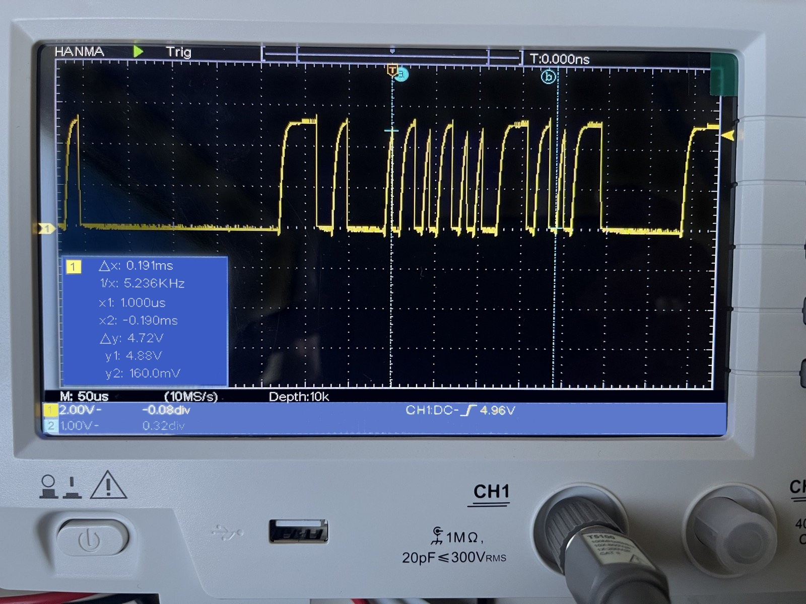
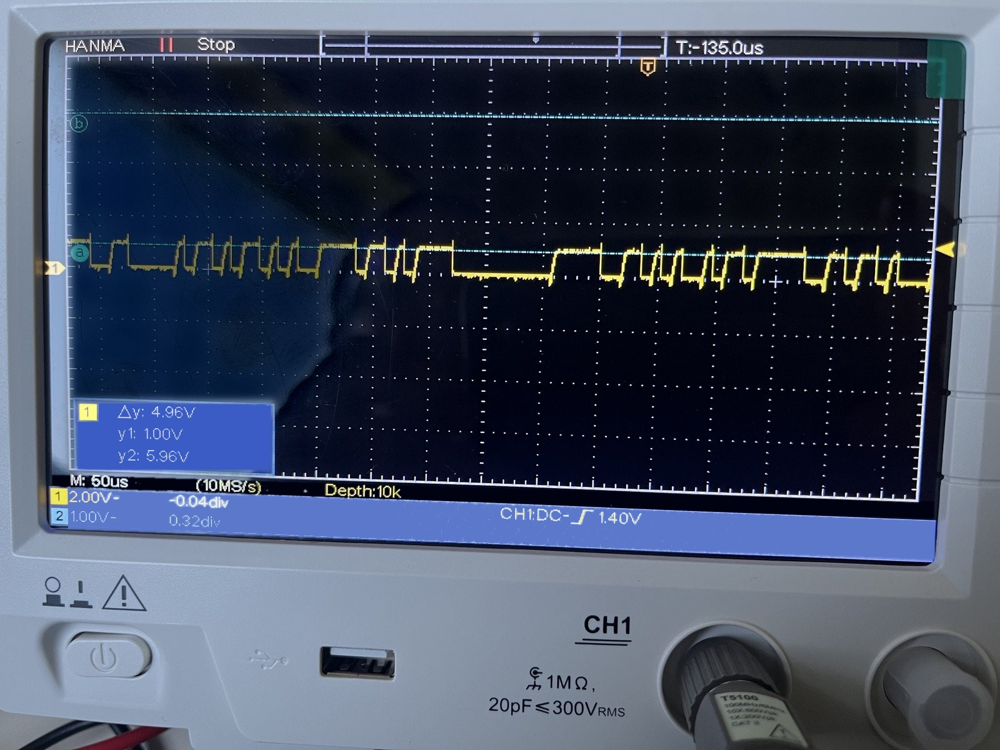
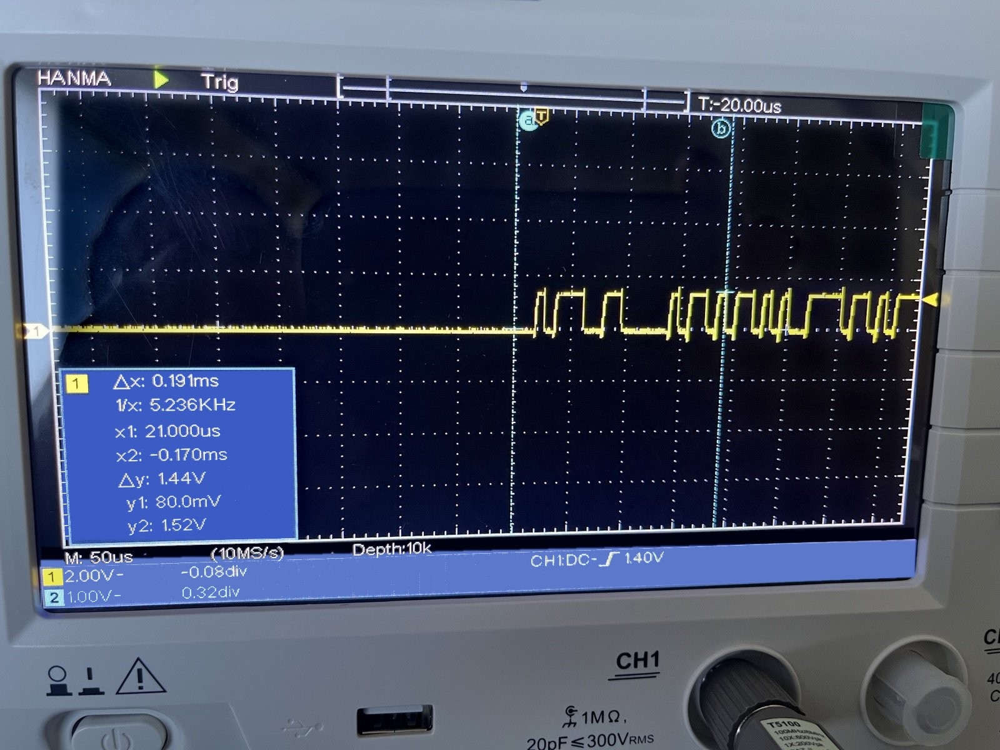
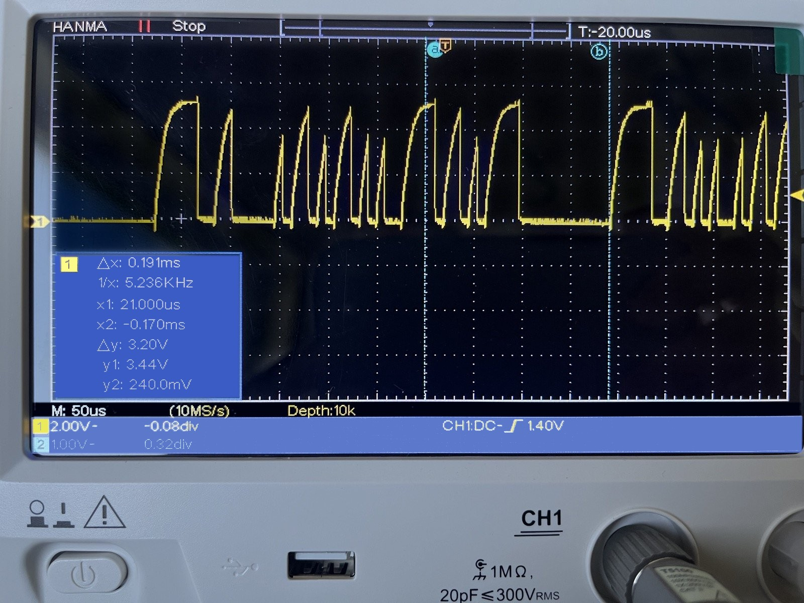
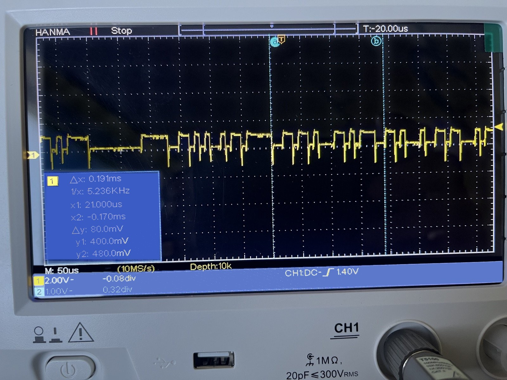

# Marstek CT003 and a second P1 reader on a passive splitter

**Date:** 2026-10-29 14:45

How one Schottky diode lets a Marstek CT003 and a second P1 reader share one
DSMR 5 P1 port through a cheap passive splitter. Tested in Belgium, on a
Landis+Gyr digital meter.

## Summary

- **Setup:** a Marstek CT003 (the P1 meter for a Marstek Venus E 3.0 home
  battery) and a SmartGateways P1 gateway share the P1 port of a Belgian
  digital meter, made by Landis+Gyr. Belgian meters follow DSMR 5 on the P1
  port. The devices connect through a passive RJ12 splitter. Each device has
  its own 5 V power supply.
- **Problem:** each device works when it is alone on the splitter. When the
  CT003 is connected as well, the SmartGateway stops receiving telegrams. The
  CT003 keeps working.
- **Cause:** the data input of the CT003 clamps the P1 data line at about
  1 V (1.5 V when the second reader is also connected). The second reader
  then never sees a valid "high" level.
- **Solution:** put one small Schottky diode in the data line (pin 5) to the
  CT003, with the cathode toward the meter. Both devices now read the meter at
  the same time. No active splitter is needed.


## P1 port basics (DSMR 5)

| Pin | Signal | Notes |
|---|---|---|
| 1 | +5 V | Power from the meter, max. 250 mA |
| 2 | Data Request | Must be high (≥ 4 V) for the meter to send |
| 3 | Data GND | |
| 4 | n.c. | |
| 5 | Data | Open collector, inverted serial, 115200 baud |
| 6 | Power GND | |

The meter output on pin 5 is an **open collector**. The meter can only pull
the line low. The reader must supply a **pull-up** that pulls the line to a
high level. On a passive splitter, all readers are connected in parallel to
this one line. So the input of each reader also loads the line for the other
readers.

## Measurements

The measurements were done with an oscilloscope on a self-made breakout box
between the splitter and the devices. All measurements are pin 5 (Data)
against pin 3 (Data GND), at 2 V/div and 50 µs/div.

The photos were edited to reduce reflections on the screen. The traces, the
grid and all values on the screen are unchanged.

Data Request (pin 2) was always at 5 V in every situation. A 4k7 pull-up from
pin 1 to pin 2 was added in the breakout box. So Data Request is not the cause.

Data line results:

| Situation | Low | High | Result |
|---|---|---|---|
| Nothing connected | 0 V | 0 V | No pull-up, so no signal |
| SmartGateway only | 0.16 V | 4.88 V | Clean signal |
| CT003 only | ~0.1 V | **~1.0 V** | The CT003 still reads |
| Both, no diode | 0.08 V | **1.52 V** | SmartGateway receives nothing |
| Both, Schottky diode, meter side | 0.24 V | 3.44 V | **Both read** |
| Both, Schottky diode, CT003 side | ~0.4–0.5 V | CT003 idle level | Negative spikes on falling edges |

### Gateway only

The SmartGateway has a normal pull-up to 5 V and a high-impedance input. The signal
switches between 0.16 V and 4.88 V.



### CT003 only

The CT003 does not pull the line to 5 V. The high level is only about 1.0 V
(cursor a in the photo is set to 1.00 V). Something in the CT003 input is
connected directly to the line and limits the voltage. It behaves like a
diode: with more current (from the SmartGateway pull-up, see below), the level
rises only a little, to about 1.5 V. This fits the forward voltage of an LED,
for example the LED of an optocoupler. Marstek does not publish the circuit,
so this is an assumption.

The CT003 still reads the meter, because its input only needs current, not
voltage. A similar clamping effect is described in
[esphome-p1reader issue #55](https://github.com/psvanstrom/esphome-p1reader/issues/55).



### Both devices, no diode: the issue

With both devices on the line, the CT003 input still clamps the line. The
gateway pull-up lifts it only a little: the high level is 1.52 V (cursor
measurement). This is far below a valid "high" for a 5 V input, so the
gateway receives nothing.



## Solution: a Schottky diode to the CT003

Put a small Schottky diode in the Data line (pin 5) to the CT003 only. Connect
the **cathode (the side with the band) toward the meter and SmartGateway**, and the
anode toward the CT003.

```
 P1 meter ──┬───────────────────────── SmartGateway  (pin 5, Data)
  (pin 5)   │
            └───|◄──────────────────── CT003          (pin 5, Data)
             cathode  anode
```

All other pins (1, 2, 3, 6) stay connected as before.

How it works:

- **The meter pulls the line low.** The diode conducts. The CT003 input is
  pulled down to the line voltage plus the low forward voltage of the Schottky
  diode. This is low enough to switch the CT003 input off, so the CT003 sees a
  "low".
- **The meter releases the line.** The diode blocks. The CT003 input is no
  longer connected to the line, so it cannot clamp the line at 1.5 V. The
  SmartGateway pull-up pulls the line high, and the CT003 input goes back to its
  own idle level.

Use a **Schottky** diode. **The BAT85 is a good choice:** a cheap,
small-signal Schottky diode with a low capacitance (about 10 pF). The BAT43
and BAT46 are similar. A larger type such as the 1N5817 also works, but it has
more capacitance. The
forward voltage is about 0.2–0.4 V. A normal silicon diode, such as the 1N4148,
has about 0.6–0.7 V. That gives a higher "low" level on the CT003 side, so
there is less margin before the CT003 no longer sees a "low". A normal diode
was not tested.

**Tested with:** one half of an MBR20100CT. This is a 20 A / 100 V dual power
Schottky diode, far larger than needed. It was simply the part at hand. A
power diode has a much larger junction capacitance and reverse leakage than a
small-signal Schottky diode. This probably causes the slower rising edges and
the lower high level in the result below. A small-signal type such as the
BAT85 is expected to do better, but that is not tested yet.

### Result

With both devices connected and the diode in place, the line switches between
0.24 V and 3.44 V. The high level is lower than with the SmartGateway alone, and
the rising edges are slower, but the SmartGateway decodes every telegram. The
CT003 also keeps working.



### The CT003 side of the diode

The photo below shows the CT003 side of the diode, with both devices
connected. Read from the screen grid, the levels are approximate:

- **Low:** about 0.4–0.5 V. This is the line low (0.24 V) plus the forward
  voltage of the diode. It is low enough: the CT003 reads correctly.
- **High:** about the same level as with the CT003 alone. When the diode
  blocks, the CT003 input goes back to its own idle level.
- **Negative spikes of up to about −0.9 V** on every falling edge.

The negative spikes come from the diode capacitance. The meter pulls the line
low very fast, and the junction capacitance of the diode passes this fast edge
to the CT003 side. On the CT003 side, nothing holds the voltage firmly, so the
edge pushes it below 0 V for a short time. The rising edges are slow (they come
from the pull-up), so they do not cause a large spike. The large power diode
that was used here has a high capacitance, which makes this effect stronger.
A small-signal Schottky diode has a much lower capacitance and is expected to
give much smaller spikes. A long ground lead on the probe can also add ringing
to the measurement.

The CT003 works correctly with these spikes, but they are not intended. This
is one more reason to use a small-signal Schottky diode such as the BAT85.



Functional check after the change:

- The SmartGateway web interface and its API show live values that change every
  second. The Home Assistant DSMR sensors update again.
- The battery API (`EM.GetStatus`) reports live CT003 values. The per-phase
  power and the energy counters change on every poll.
- Both devices report the same values: the same power per phase, and the same
  total energy counters.

## Notes and limits

- **3.44 V is a smaller margin than 4.88 V.** It works with this SmartGateway. A
  reader with a weaker pull-up, or a longer cable, may not work.
  Check the signal with an oscilloscope when you change the setup.
- **If the diode is not enough,** a series resistor in the CT003 data line is
  an alternative. That is a trade-off: a larger resistor gives a better high
  level for the other reader, but it can stop the CT003 from seeing a "low".
  The diode avoids this trade-off.
- **An active P1 splitter** buffers each port. It is the solution without any
  soldering.
- The CT003 behaviour is measured, not documented. Marstek does not publish
  the CT003 input circuit, and a future hardware revision can behave
  differently.
- Work only in the splitter or in a breakout box. Never open the meter.

## License

This text and the images are licensed under
[CC BY 4.0](https://creativecommons.org/licenses/by/4.0/). See [LICENSE](LICENSE).
